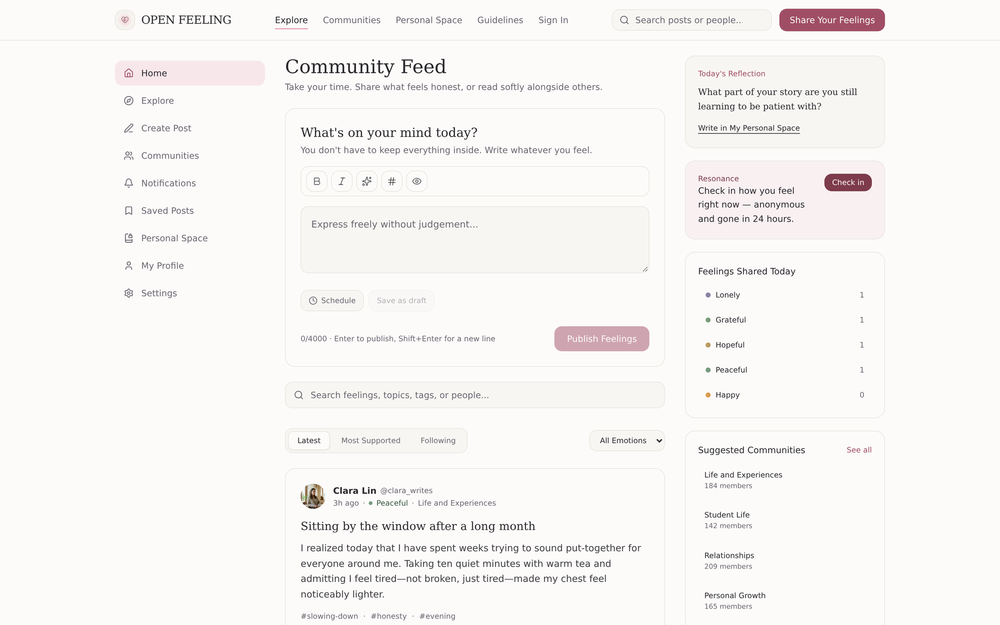
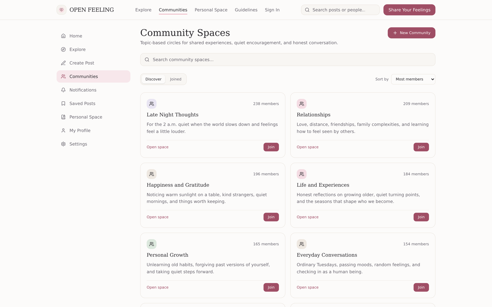
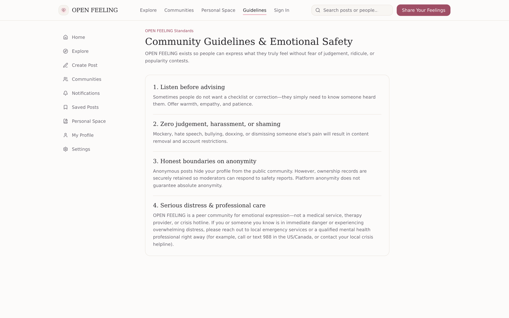
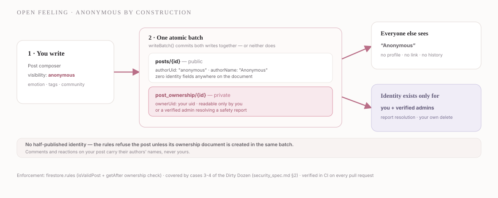
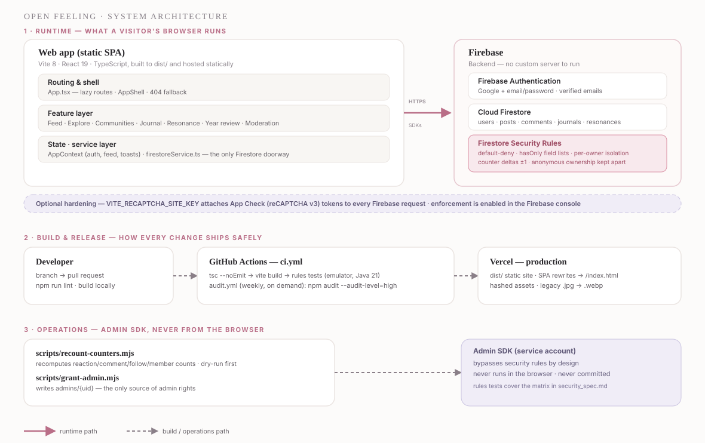
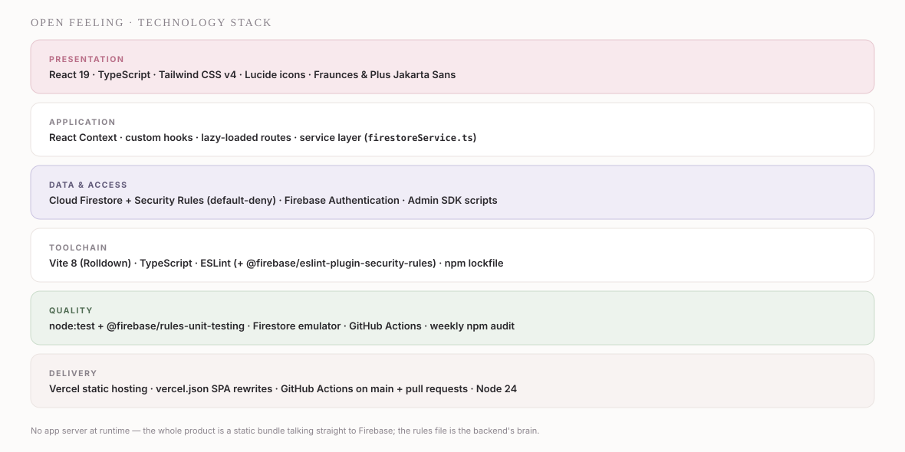

<p align="center">
  
</p>

<h1 align="center">OPEN FEELING</h1>

<p align="center">
  <strong>Express freely. Feel lighter.</strong><br />
  <sub>A calm, anonymous-first space to share emotions, keep a private journal, and find people who understand — without judgement, without performance.</sub>
</p>

<p align="center">
  <a href="https://github.com/ramrounakmukherjee-blip/OPEN-FEELING/actions/workflows/ci.yml"></a>
  <a href="https://github.com/ramrounakmukherjee-blip/OPEN-FEELING/actions/workflows/audit.yml"></a>
  
</p>

<p align="center">
  
</p>

<p align="center"><sub>
  OPEN FEELING is a client-side React + Firebase application. Firestore security rules are the source of truth for access control — there is no app server at runtime.
</sub></p>

<p align="center">
  <a href="#features">Features</a> ·
  <a href="#screenshots">Screenshots</a> ·
  <a href="#anonymous-by-construction">Anonymous by construction</a> ·
  <a href="#system-architecture">Architecture</a> ·
  <a href="#technology-stack">Stack</a> ·
  <a href="#getting-started">Getting started</a> ·
  <a href="#firebase-security-and-data">Security</a> ·
  <a href="#contributing">Contributing</a>
</p>

---

## Why OPEN FEELING?

Sometimes we have so much to say but nowhere to say it. OPEN FEELING is a welcoming digital
space for sharing emotions, writing privately, and connecting with people who understand. It is
built around three quiet promises:

1. **Honesty over performance.** Post publicly, anonymously, or keep it entirely private — your call, every time.
2. **Safety by construction, not by moderation alone.** Anonymity and access control are enforced by the database itself, in committed security rules, tested in CI.
3. **A calm interface.** Soft light, gentle color, no dopamine traps — and ambient touches like drifting petals you can pause anytime.

## Features

| Feature | What it does |
| --- | --- |
| **Expressive posts** | Share feelings with emotion tags, public/anonymous/private visibility, communities, and optional media. |
| **Explore & feed** | Browse stories, filter by a dozen emotions, search topics and tags, and discover what others are feeling. |
| **Communities** | Join topic-based spaces — *Late Night Thoughts*, *Relationships*, *Personal Growth*, and more — with member counts and community rules. |
| **Reactions & comments** | Respond with five meaningful reactions — *I Understand · Sending Love · You're Not Alone · Stay Strong · Thank You for Sharing* — and thoughtful comments. |
| **Private journal** | My Personal Space: entries, drafts, reflections, and letters to your future self — visible only to you. |
| **Resonance check-ins** | Anonymous 24-hour emotional check-ins with a single supportive line of care per emotion — then they dissolve. |
| **Year in review** | A gentle recap of your writing and emotional patterns across the year. |
| **Notifications** | Reactions, comments, follows, and community activity — surfaced without noise. |
| **Profiles & privacy** | Edit your profile, manage saved posts, privacy settings, follows, blocks, and account preferences. |
| **Moderation & safety** | Community guidelines, reporting flows, and admin-gated moderation — with identity resolution only for verified admins. |
| **Accessible, calm UI** | Responsive layout, keyboard shortcuts (<kbd>Ctrl</kbd>/<kbd>⌘</kbd> + <kbd>K</kbd> focuses search), reduced-motion support, contrast-conscious styling. |

### Screenshots

> Real captures of the running app, shown with the built-in sample content that makes a fresh environment feel alive.

<p align="center">
  
  <br /><sub><strong>Community Feed</strong> — a quiet place to write what you feel, see today's reflection, and check in anonymously.</sub>
</p>

<p align="center">
  
  <br /><sub><strong>Explore &amp; Discover</strong> — every story tagged with an emotion; filter by how you feel, not just what you think.</sub>
</p>

<table align="center">
  <tr>
    <td align="center" width="50%">
      
      <br /><sub><strong>Community Spaces</strong> — topic-based circles with quiet, honest conversation.</sub>
    </td>
    <td align="center" width="50%">
      
      <br /><sub><strong>Community Guidelines</strong> — emotional safety written down, in plain language.</sub>
    </td>
  </tr>
</table>

## Anonymous by Construction

Many apps *promise* anonymity; OPEN FEELING *enforces* it. When you post anonymously, one atomic
batch writes two documents: a **public** post with every identity field stripped (`authorUid:
"anonymous"`, `authorName: "Anonymous"`), and a **private** ownership record readable only by you —
or by a verified admin resolving a safety report. The security rules refuse the post outright if
its ownership document isn't created in the same batch.

<p align="center">
  
</p>

<p align="center">
  
  <br /><sub>Illustration — quiet honesty, sealed and delivered.</sub>
</p>

- **No half-published identity.** The `getAfter` rules check requires the `post_ownership` document to exist after the batch commits — tested adversarially in `security_spec.md` (case 4, *Orphaned Anonymous Post*).
- **Spoofing is impossible.** A post claiming an arbitrary `authorUid` while `visibility: "anonymous"` is rejected (case 3, *Anonymous Identity Spoof*).
- **Identity resolution is deliberate.** Only the owner (delete, edit) and verified admins (safety reports) can ever resolve who stands behind an anonymous post. Email claims grant nothing — the `admins/{uid}` registry is the only source of admin rights.

## Your Personal Space

Some things aren't meant for anyone else yet. **My Personal Space** is a private journal with
drafts, reflections, and **letters to your future self** — scheduled notes that wait for you down
the road. Private posts and journal entries are readable strictly by their owner (or an admin);
the rules test this exhaustively.

<p align="center">
  
  
  <br /><sub>A private journal for the unfiltered version of you &nbsp;·&nbsp; Resonance check-ins: anonymous, lightweight, and gone in 24 hours.</sub>
</p>

## Resonance — Check In, Then Let Go

Resonance is a lightweight, anonymous pulse: *how are you feeling right now?* — one tap, and a
quiet acknowledgement from people who understand. Check-ins and the single supportive lines of
care attached to them **expire after 24 hours** by design (`resonances.expiresAt`, enforced in
the rules), so yesterday's heaviness never becomes a permanent monument.

## System Architecture

OPEN FEELING is intentionally simple at runtime: a static single-page app in your browser talks
directly to Firebase. All authority — who can read what, who can write what, what a valid
document looks like — lives in `firestore.rules`, the backend's brain, verified in CI on every
pull request.

<p align="center">
  
</p>

Three planes, one rule — **no secrets in the browser**:

| Plane | What runs there | Who can do what |
| --- | --- | --- |
| **Runtime** | The static SPA + Firebase SDKs | Browsers can do exactly what `firestore.rules` permits — nothing more |
| **Build & release** | Vite → GitHub Actions → Vercel | CI typechecks, builds, and runs the rules suite before anything ships |
| **Operations** | Admin SDK scripts on a trusted machine | Service-account only; bypasses rules by design; never runs in the client |

The Firebase web `apiKey` in `firebase-applet-config.json` is a client identifier, not a secret —
access control is the rules file, full stop. Optional hardening (App Check with reCAPTCHA v3) is
covered in [Security](#app-check).

## Technology Stack

<p align="center">
  
</p>

| Layer | Technology |
| --- | --- |
| Framework | [React 19](https://react.dev/) + [TypeScript](https://www.typescriptlang.org/) |
| Build | [Vite 8](https://vite.dev/) (Rolldown) |
| Styling | [Tailwind CSS v4](https://tailwindcss.com/) · [Lucide](https://lucide.dev/) icons · Fraunces &amp; Plus Jakarta Sans |
| Backend services | [Firebase Authentication](https://firebase.google.com/docs/auth) + [Cloud Firestore](https://firebase.google.com/docs/firestore) + Security Rules (default-deny) |
| Testing | Firestore emulator + [`@firebase/rules-unit-testing`](https://www.npmjs.com/package/@firebase/rules-unit-testing) + Node test runner |
| Hosting | [Vercel](https://vercel.com/) static output (`dist/`) with `vercel.json` rewrites |
| Quality gates | `tsc --noEmit` · ESLint (+ `@firebase/eslint-plugin-security-rules`) · GitHub Actions · weekly `npm audit` |

Offline maintenance tooling lives in [`tools/`](./tools) (Python + Java) and runs in CI — see
[Offline developer utilities](#offline-developer-utilities). Neither tool adds a backend; the
deployed product remains React + Firebase.

## Project Structure

```text
.
├── .github/workflows/       # ci.yml (typecheck · build · rules tests) and audit.yml (weekly npm audit)
├── docs/                    # Architecture & stack diagrams, screenshots, illustrations
├── public/                  # Static assets (artwork, icons, favicon)
├── scripts/                 # Admin SDK maintenance scripts (counter recount, grant-admin)
├── src/
│   ├── components/          # Reusable UI components
│   ├── constants/           # Emotion / reaction / prompt constants
│   ├── context/             # App context and shared state
│   ├── data/                # Starter/sample data (dev-only)
│   ├── lib/                 # Firebase/features setup
│   ├── pages/               # Route-level pages
│   ├── services/            # Firestore/service layer (the only Firestore doorway)
│   ├── types/               # Shared TypeScript types
│   ├── utils/               # Utility helpers
│   ├── App.tsx              # App shell and routing
│   ├── index.css            # Global styles/tokens
│   └── main.tsx             # Entry point
├── tests/                   # Firestore rules tests (emulator)
├── tools/
│   ├── python/              # Offline journal-export validator + tests
│   └── java/                # Offline repository health check
├── firebase-applet-config.json
├── firestore.rules          # Firestore security rules (source of truth for access)
├── security_spec.md         # Security invariants and the Dirty Dozen adversarial cases
└── package.json
```

## Getting Started

### Prerequisites

- **Node.js** ≥ 24.12.0 (required by the Firestore rules test tooling)
- **npm** ≥ 10
- **Java 11+** and **Firebase CLI** on `PATH` only if you want to run Firestore rules tests locally

### Installation

```bash
npm ci
```

### Local development

```bash
npm run dev
```

The app starts at [http://localhost:3000](http://localhost:3000).

### Environment variables

Firebase web configuration lives in `firebase-applet-config.json`. The Firebase `apiKey` is a
client identifier, not a secret; access control is enforced by `firestore.rules`.

Copy `.env.example` to `.env.local` only if you need local overrides:

```bash
cp .env.example .env.local
```

| Variable | Purpose | Default |
| --- | --- | --- |
| `VITE_RECAPTCHA_SITE_KEY` | Optional Firebase App Check (reCAPTCHA v3) site key. | unset |
| `VITE_ENABLE_SAMPLE_CONTENT` | Show starter/sample content when the database is empty. Intended for local development only. | `false` in example / production-safe behavior |
| `VITE_ENABLE_STARTER_SEED` | Allow starter-community seeding from a client session. Use deliberately in development only. | `false` |

## Available Scripts

| Command | Purpose |
| --- | --- |
| `npm run dev` | Start the development server on port 3000 |
| `npm run build` | Create a production build in `dist/` |
| `npm run preview` | Preview the production build locally |
| `npm run lint` | TypeScript typecheck (`tsc --noEmit`) |
| `npm run lint:eslint` | Run ESLint |
| `npm run clean` | Remove `dist/` and `server.js` |
| `npm run test:rules` | Run Firestore rules tests against the emulator |
| `npm run backfill:counters` | Dry-run recount of aggregate counters (`--apply` to write) |
| `npm run grant-admin` | Grant admin access to a user by email |

## Firebase, Security, and Data

### Firestore rules

`firestore.rules` is the source of truth for data access. `security_spec.md` documents the
invariants (§1) and the **Dirty Dozen** adversarial cases (§2) that the rules are tested against —
shadow-admin escalation, shadow-field injection, anonymous identity spoofing, orphaned anonymous
posts, client timestamp forgery, reaction impersonation, and more.

Deploy rules with:

```bash
firebase deploy --only firestore:rules
```

### Firestore rules tests

Rules tests live in `tests/` and run against the Firestore emulator:

```bash
npm run test:rules
```

Requirements:

- Java 11+
- Firebase CLI available on `PATH`

See [`tests/README.md`](./tests/README.md) for details.

### App Check

The Firebase web SDK can attach App Check attestation tokens (reCAPTCHA v3) to requests.

1. Create/register a reCAPTCHA v3 key in Firebase Console > App Check.
2. Set `VITE_RECAPTCHA_SITE_KEY` in `.env.local` and your hosting environment.
3. Enable App Check **enforcement** for Cloud Firestore in Firebase Console.
4. Monitor App Check metrics before tightening further.

> App Check initialization alone does not block abuse; enforcement does. Per-user write
> quotas/rate limits are not fully enforceable in Firestore security rules alone; hard rate
> limiting requires a backend/service-side control.

### Admin access

Admin rights derive from the `admins/{uid}` registry in Firestore (mirroring `firestore.rules`).
Email claims do not grant privileges.

Grant admin access:

```bash
export GOOGLE_APPLICATION_CREDENTIALS=/path/to/serviceAccount.json
npm run grant-admin -- user@example.com
```

To revoke access, delete the corresponding `admins/{uid}` document in Firebase Console.

> Before deploying rules changes that remove any legacy bootstrap admin path, ensure at least one
> `admins/{uid}` document exists and that you can sign in with that account.

### Counter maintenance

Aggregate counters (`reactionCounts`, `commentsCount`, `followersCount`, `followingCount`,
`memberCount`) are maintained with `FieldValue.increment()` and bounded by security rules (single
reaction key changed, delta exactly ±1, only when the matching reaction document is written —
plus the equivalent `commentsCount` bound). Older data may contain drift.

Repair drift with the Admin SDK script:

```bash
export GOOGLE_APPLICATION_CREDENTIALS=/path/to/serviceAccount.json
npm run backfill:counters            # dry run: prints drift, writes nothing
npm run backfill:counters -- --apply # write corrections
```

The script is idempotent, bypasses security rules by design, and never deletes documents.
Review the dry-run output before applying changes.

## Offline Developer Utilities

The deployed app remains React + Firebase. Python and Java are used for local maintenance checks
only; neither adds a backend service or runs in the user-facing app.

### Python: validate a journal export

Run this locally against a Markdown export from My Personal Space:

```bash
python tools/python/check_journal_export.py path/to/open-feeling-journal.md
```

The validator checks the export header, entry date headings, and basic structure. It does not
print or upload journal text. Run its tests with:

```bash
python -m unittest discover -s tools/python -p 'test_*.py'
```

### Java: check repository essentials

With Java 21 or newer:

```bash
mkdir -p /tmp/open-feeling-check
javac -d /tmp/open-feeling-check tools/java/ProjectHealthCheck.java
java -cp /tmp/open-feeling-check ProjectHealthCheck .
```

This checks that core project files exist, Firestore retains its default-deny rule, and pull
requests trigger CI. It does not access Firebase or require credentials.

Both utilities run in GitHub Actions as part of the pull request checks.

## Sample Content & Seeding

Starter posts/communities are intended to make a fresh local environment feel alive. In
production builds, sample fallback is disabled so an empty database renders real empty states,
not fake posts.

- Local development can opt into sample content via `VITE_ENABLE_SAMPLE_CONTENT`.
- Starter community seeding runs only when `VITE_ENABLE_STARTER_SEED=true`.
- Keep both disabled in production unless you intentionally need a controlled bootstrap flow.

## CI

GitHub Actions workflows live in `.github/workflows/`:

- **`ci.yml`** — Runs typecheck, build, the offline Python/Java checks, and Firestore rules tests on pushes to `main` and pull requests.
- **`audit.yml`** — Runs dependency audits weekly and on demand (`npm audit --audit-level=high`).

## Contributing

1. Create a branch for your change.
2. Keep changes focused and consistent with existing patterns.
3. Run checks before opening a PR:

```bash
npm run lint
npm run build
npm run test:rules   # requires Java + Firebase CLI
```

4. For security-sensitive changes, update `firestore.rules`, tests, and `security_spec.md` together.

## Notes

- This repository contains client-side Firebase configuration intended for public web apps; secrets should not be committed.
- Deployment is configured for Vite static output (`dist/`) and includes `vercel.json` for hosting rewrites.
- For project-specific operational details, also see [`security_spec.md`](./security_spec.md) and [`tests/README.md`](./tests/README.md).

---

<p align="center">
  <br />
  <em>Express freely. Feel lighter.</em>
</p>
